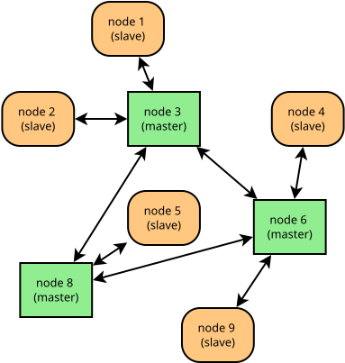
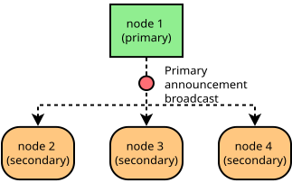
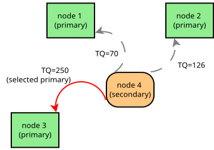
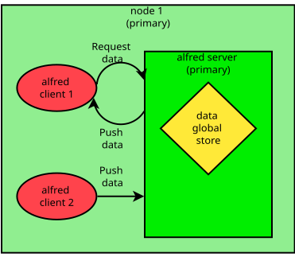
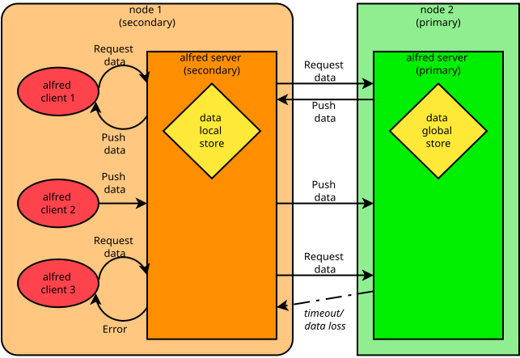
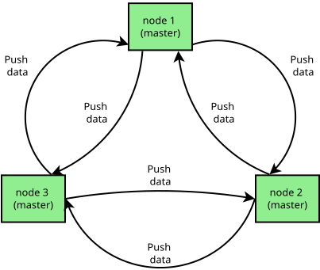
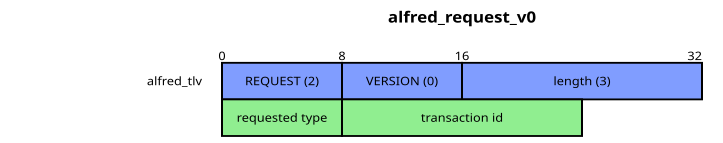
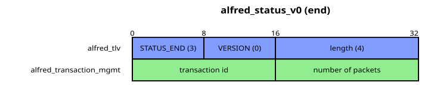
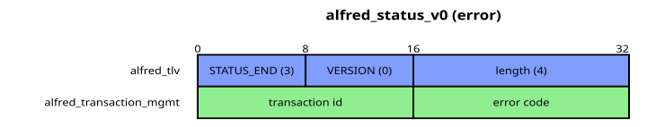
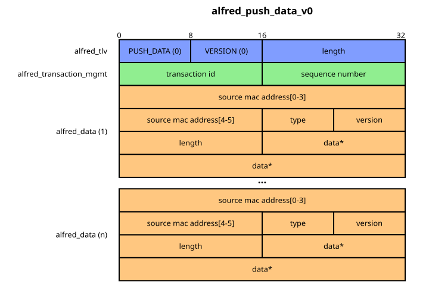

.. SPDX-License-Identifier: GPL-2.0

============
Architecture
============

Introduction
============

alfred is a user space daemon for distributing arbitrary local
information over the mesh/network in a decentralized fashion. This data
can be anything which appears to be useful - originally designed to
replace the batman-adv visualization (vis), you may distribute
hostnames, phone books, administration information, DNS information, the
local weather forecast ...

Typically, alfred runs as unix daemon in the background of the system. A
user may insert information by using the alfred binary on the command
line, or use custom written programs to communicate with alfred directly
through unix sockets. Once the local data is received, the alfred daemon
takes care of distributing this information to other alfred servers on
other nodes somewhere in the network. As addressing scheme IPv6
link-local multicast addresses are used which do not require any manual
configuration. A user can request data from alfred, and will receive the
information available from all alfred servers in the network.

Alfred specific terms
=====================

node
  a node is a device able to run alfred
server
  an alfred instance running on a node, able to communicate with alfred processes on other nodes and with clients running on the same node
client
  a program which supports the alfred protocol and communicates with the alfred server on the same node
primary
  an alfred server process which stores incoming data, synchronizes it with other primary servers and accepts requests/data from secondaries
secondary
  an alfred server process which only manages its own data, pushes/requests the data to/from **its** primary server

Network
=======

Structure
---------

An alfred network used for exchanging data is built using different
nodes running an alfred server. Servers are detected and connect to each
other automatically.

|image0|

Such a network has to contain at least one primary server. Primary
servers are used as global data storage and help to synchronize data
with other nodes. This role is so important that they actively announce
there presence to all nodes. Other primary servers are automatically
synchronizing their stored data to have it distributed to all reachable
primary nodes.

The other type of servers are secondaries. Secondaries don't try to
gather all data stored in the alfred network. Instead they only connect
to their best primary server to request data when required and to push
the data from local clients to the alfred network through primary
servers.

Network layer
-------------

All communication between servers in an alfred network is done through
IPv6 link-local UDP messages. This only allows communication in the
current subnet but messages will not be routed between different
subnets.

Alternatively, alfred can operate in IPv4 mode (``-4 <group-address>``).
The IPv6 link-local multicast messages are then replaced by IPv4
multicast messages to the given group address.

A server can listen on multiple interfaces at the same time. They are
given as comma separated list (for example ``-i br0,eth1``).

The underlying layer can for example be batman-adv which makes all nodes
in a mesh look like being connected to a big switch. This makes it
possible to reach all nodes even in situations where they would not be
able to reach each other through the actual link medium. Therefore,
link-local messages are enough for this scenario. Deployments with a
different kind of underlying layer may have to evaluate if they can
provide a medium which also provides IPv6 link-local communication
between all nodes.

All the messages are sent through the IANA unregistered UDP/IPv6 port
0x4242 (in decimal: 16962).

Detection of neighbors
----------------------

The primary server will announce itself using IPv6 link-local multicast
messages. This makes it possible to reach all nodes with a single
message unless it is dropped while being forwarded/transmitted.

|image1|

The periodically transmitted announcement multicast messages will
be received by the other alfred servers and be stored for later. The
announcement interval is the synchronization period (default: 10s, can
be changed with ``-p``/``--sync-period``). Primary
servers use this information to synchronize data and secondary servers
use it to have access to the global data.

|image2|

The secondary servers need therefore a way to find their best primary
server. batman-adv networks already provide the TQ value to quantify the
quality to a primary server. The best primary server is the server with
the best TQ for a secondary node. When batman-adv is not used
(``-b none``), all primary servers are considered equal and an arbitrary
one is chosen.

The mac address is used by alfred to associate the messages with an
unique data source. In IPv6 mode, it is calculated by evaluating the
received UDP/IPv6 packet source address. In IPv4 mode, it is retrieved
via ARP. The mac address is mapped to the originator of the primary
server using batman-adv's translation table. The TQ of this originator
is then retrieved from batman-adv via netlink.

Detected neighbor servers are automatically dropped after a timeout of
60s since the last announcement was received.

Client data exchange
--------------------

The client communication to the alfred server is done through unix
sockets on the same node. The default path is ``/var/run/alfred.sock``
and can be changed with ``-u``/``--unix-path``.

The used packet format is shared between the server2server and the
client2server communication. There are some minor differences which will
be explained later.

The easiest communication is the push of data to an server. The client
has to create a alfred\_push\_data packet with the attached data at the
end. The server receives it, stores it, closes the client connection and
handles the forwarding of the data to the other servers in the alfred
network.

The client should set the source mac address of the data block to
00:00:00:00:00:00. The server will then replace it with the mac address
of its (first) interface. Only servers in primary mode accept data with a
different source mac address from clients.

Slightly more complicated is the request of data from a primary server.
The client has to send an alfred\_request packet to the primary server
with the type it requests. The reply will be an arbitrary number of
alfred\_push\_data packets of the requested type which contain the data
set by the clients on this node and from other nodes. The data from
other servers will only be as new as the latest successful data
synchronization.

|image3|

The alfred request to an secondary server looks exactly the same as the
request to a primary server. But the secondary server doesn't store all
data which is currently in the alfred network. Instead the secondary
server has to ask its primary server to send information for this type
to the secondary server. This is done the same way as a client would do
it but through a link-local UDP/IPv6 message. The request will be
replied by the server with alfred\_push\_data packets and a single
alfred\_status end packet containing the number of sent alfred\_push\_data
packets.

This request can fail for different reasons. The secondary server uses
an timeout (10s) for these requests and informs the client using an
alfred\_packet\_status error message that the request failed. Otherwise
the secondary server will reply with alfred\_push\_data packets the same
way as a primary server.

|image4|

The best practice for a client is to implement the handling of error
messages even when it is only used together with primary servers.

Clients can also be informed about changes of the stored data:

* a client can register for events with an alfred\_event\_register
  packet (``alfred -E``). The server keeps the connection open and sends
  an alfred\_event\_notify packet with the data type and source mac
  address whenever a data record was added or changed.
* the server can execute a command when data changed
  (``-c``/``--update-command``). The numbers of the changed data types
  are appended as arguments to the command.

Synchronization
---------------

Data synchronizations are done primary2primary and secondary2primary.
The secondary will only send data from its clients to a single server.
Primary servers are sending their stored data to all other known primary
servers. This only contains the data from their local clients and data
pushed from secondary server.

|image5|

The synchronization is started pro-actively by the secondary or primary
server every synchronization period (default: 10s). It is initiated by an alfred\_push\_data packet with a
transaction id and the first data blocks. This transaction id should be
unique for the time of the synchronization but the same for all packets
of a synchronization transaction.

The last packet is an alfred\_status end packet with the number of sent
alfred\_push\_data packets during this synchronization transaction. If it
doesn't match with the number of packets the primary server received,
then the transaction failed and the remote primary server drops the
received data.

Data is automatically pruned from the server storage 600s after the last
time it was received/refreshed.

Packet formats
==============

General format
--------------

The data stored in the packet headers is always stored in network byte
order (big endian). The packet format is TLV based (type, value, length)
which appears in different headers. The type is only defined by alfred
for the outer TLV and can be:

.. list-table::
   :header-rows: 1

   * - Type
     - Name
     - Used for
   * - 0
     - PUSH\_DATA
     - network + unix socket
   * - 1
     - ANNOUNCE\_PRIMARY
     - network
   * - 2
     - REQUEST
     - network + unix socket
   * - 3
     - STATUS\_TXEND
     - network
   * - 4
     - STATUS\_ERROR
     - unix socket
   * - 5
     - MODESWITCH
     - unix socket
   * - 6
     - CHANGE\_INTERFACE
     - unix socket
   * - 7
     - CHANGE\_BAT\_IFACE
     - unix socket
   * - 8
     - SERVER\_STATUS
     - unix socket
   * - 9
     - EVENT\_REGISTER
     - unix socket
   * - 10
     - EVENT\_NOTIFY
     - unix socket

The types 5 to 10 are only used to control the local server and are
described in `Unix socket control messages`_.

The length value is always the length of the payload following the TLV.
This is especially important when multiple TLV + payload blocks appear
after each other.

The version field is also only defined for the outer TLV and has to be 0
for the specified first packet format.

Primary announcement
--------------------

|image6|

The announcement is only done by the primary servers to announce
themselves via link-local UDP/IPv6 multicast. It doesn't contain any
more information. The receiver has to calculate the mac address of the
sender by decoding the link-local IPv6 sender address.

Request data
------------

|image7|

Requests are done by clients via unix socket or by secondary servers via
link-local UDP/IPv6 unicast.

The requested type is the type of data which the transmitter wants to
receive. The alfred\_push\_data packets sent as reply must only contain
data blocks from this type.

The transaction id must be unique during the time the request is made
and answered.

Finish transaction
------------------

|image8|

Servers send status end packets via link-local UDP/IPv6 unicast. It is
the last packet of a transaction (synchronization or reply to a
request). The transaction id has to be equal to the transaction id of
the alfred\_push\_data packets and the alfred\_request. The number of
packets has to be equal to the number of alfred\_push\_data packets with
the same transaction id to accept the transaction as successful.

Inform about an error
---------------------

Secondary servers send error messages via unix sockets to clients. This
tells the client that the request of data from the primary server
failed. The transaction id has to be same as the transaction id of the
alfred\_request packet.

|image9|

The only currently used error code is 1.

Push data
---------

Push data packets are sent/received by clients to send data via unix
sockets to/from servers. Clients send it to store data on a server.
Servers send it to clients as answer to alfred\_request packets.

Servers sent push data packets via UDP/IPv6 to synchronize data between
them. Primary server also sent them to secondary server as answer to
alfred\_request packets.

The transaction id has to be unique during the time of the transaction
but the same for all packets of one transaction. The sequence number has
to be increased for each packet of a transaction.

|image10|

The payload of the alfred\_push\_data packet after the transaction
information is split into an arbitrary number of alfred\_data blocks.
Each data block is started with the mac address of the server which
initially stored the data. The next part is the TLV header which
describes the data part of the alfred\_data block. The type and version
are user/client defined. The length is the number of bytes for the data
stored after the TLV header.

The number of alfred\_data blocks in a single alfred\_push\_data has always
to be **1** for communication via unix sockets. The aggregation of
multiple data blocks is only allowed for communication via UDP/IPv6.

Alfred allows type from 64 up to 255 as general types for client data.
0 - 63 are reserved (e. g. batadv-vis(1) and alfred-gpsd(2)). The version
information has to be evaluated by a client to make sure that it can
correctly interpret the data.

One alfred packet can be up to 65527 bytes in size (the maximum UDP
payload). This limits the number of bytes per data block to 65509 bytes.

Unix socket control messages
----------------------------

The following messages are only exchanged between a client and the
server on the same node via the unix socket:

MODESWITCH (5)
  switch the server between secondary (0) and primary (1) mode
  (``alfred -M``)

CHANGE\_INTERFACE (6)
  replace the list of interfaces the server is using. The interfaces are
  given as comma separated string (``alfred -I``)

CHANGE\_BAT\_IFACE (7)
  change the batman-adv interface used for the best server selection
  (``alfred -B``)

SERVER\_STATUS (8)
  request the status of the server (``alfred -S``). The reply is a
  SERVER\_STATUS packet which contains TLVs for the operation mode, each
  network interface (including whether it is active) and the batman-adv
  interface

EVENT\_REGISTER (9)
  register the client for event notifications (``alfred -E``)

EVENT\_NOTIFY (10)
  sent by the server to registered clients when a data record was added
  or changed. It contains the data type and the source mac address of
  the record

