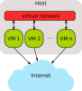

.. SPDX-License-Identifier: GPL-2.0

Emulation Environment
=====================

To give an answer to the often asked question “How to
test/evaluate/debug mesh network protocols?”, this document explains a
virtual machine setup which can be used to test batman-adv in a
controlled environment. The idea is to use
`QEMU <https://www.qemu.org/>`__ (instead of pure simulation systems
like `NS-2 <https://www.isi.edu/nsnam/ns/>`__) to run an unmodified
Linux system with the unmodified source code as it is used in real world
setups. Besides B.A.T.M.A.N., you could evaluate any routing protocol.

.. _devtools-emulation-environment-architecture:

Architecture
------------

The test stack consists of the following components:

* host running the virtual instances
* virtual instances (cloned) from a single image
* virtual network to allow communication between the virtual instances
* various debugging tools
* optional external devices and services

|image0|

Getting started
---------------

The pages below build on each other. A good reading order is:

#. Set up the basic environment with :doc:`OpenWrt_in_QEMU`. It provides
   the scripts (``virtual-network.sh``, ``run.sh`` and ``test-init.sh``)
   which are reused by all other pages.
#. Optionally switch to the :doc:`Kernel_hacking_Debian_image` when
   kernel modules should be developed and debugged extensively.
#. Replace or extend the simple virtual network to create more
   interesting topologies.
#. Use the debugging helpers to analyze the behavior of the nodes.

Virtual instances
-----------------

The main components of the testing setup are the virtual instances.
Various images can be used to create them. There is not a single image
for all tasks but the right one has to be chosen.

.. list-table::
   :header-rows: 1

   * - Image
     - Use case
   * - :doc:`OpenWrt_in_QEMU`
     - quick start, testing of OpenWrt packages
   * - :doc:`Kernel_hacking_Debian_image`
     - kernel development with self-built kernel, sanitizers and debug
       helpers

.. toctree::
   :hidden:
   :maxdepth: 1

   OpenWrt_in_QEMU
   Kernel_hacking_Debian_image

Virtual networks
----------------

The default virtual network only creates a single broadcast domain
using a bridge. This cannot be used to simulate interesting topologies.
More advanced techniques can be used to extend or replace the bridge.

.. list-table::
   :header-rows: 1

   * - Network
     - Use case
   * - :doc:`Advanced_Bridge_virtual_network`
     - restrict links, add packet loss or throughput limits using the
       host's bridge + nftables
   * - :doc:`Vde_switch_virtual_network`
     - user defined links between instances using (patched) vde_switch
       and wirefilter
   * - :doc:`Mixing_VM_with_gluon_hardware`
     - connect real hardware running gluon to the bridge based network

.. toctree::
   :hidden:
   :maxdepth: 1

   Advanced_Bridge_virtual_network
   Vde_switch_virtual_network
   Mixing_VM_with_gluon_hardware

Debugging helpers
-----------------

.. toctree::
   :maxdepth: 1

   Analyzing_virtual_network_packets

Debugging of the kernel itself (inside the virtual instances or on
real hardware) is described in :doc:`Kernel_Debugging`.

